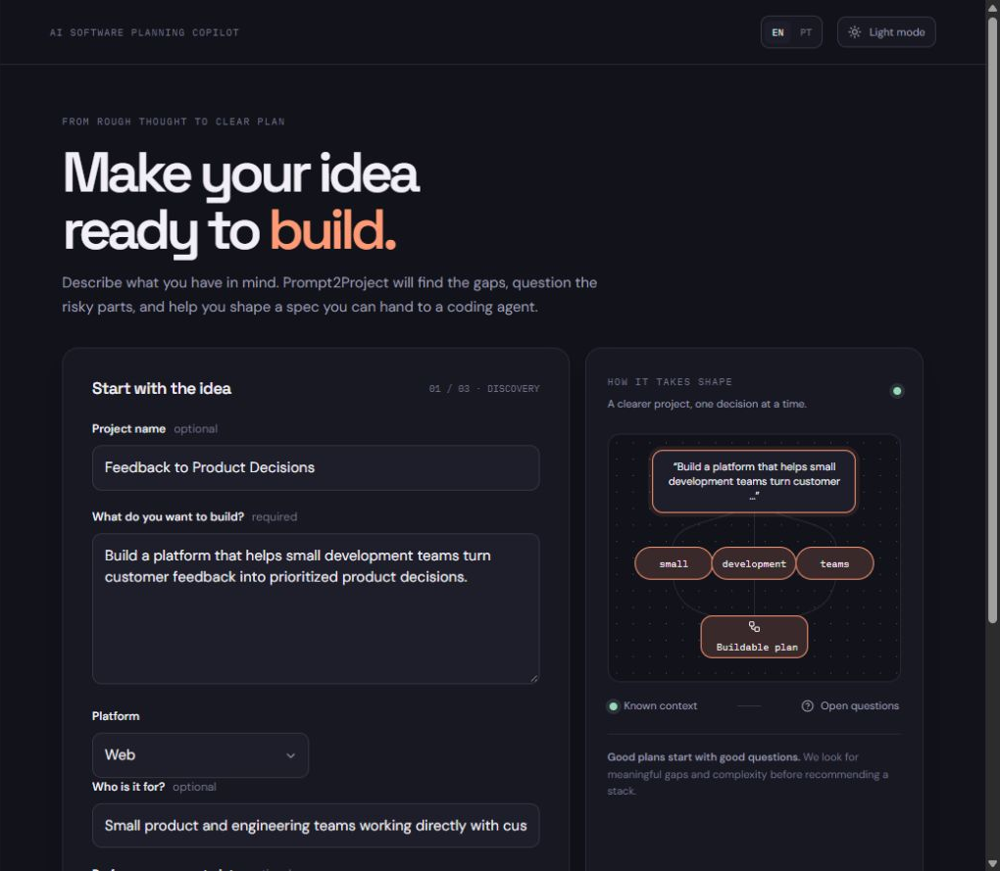

# Prompt2Project

**Turn a vague software idea into a buildable project specification.**

[](https://nextjs.org/)
[](https://www.typescriptlang.org/)
[](LICENSE)

<p>
  <a href="https://prompt2project.vercel.app"><strong>Live Demo</strong></a>
  &nbsp;·&nbsp;
  <a href="https://github.com/ledumape/prompt2project"><strong>Source Code</strong></a>
</p>

## The problem

Coding agents can write code quickly, but vague ideas force them to make arbitrary decisions. The result can have weak scope, hidden assumptions, and incomplete requirements.

## The workflow

Prompt2Project turns early product thinking into a handoff a coding agent can use:

```text
Idea → AI Discovery → Product decisions → Project Spec → Coding Agent Prompt
```

Discovery surfaces missing information and trade-offs. The user reviews recommendations and open questions before generating and editing the project specification.

## Features

- Adaptive AI discovery questions based on the project idea.
- Product Engineer recommendations with **accept** or **keep my approach** decisions.
- Open questions remain visible when the user has not decided.
- Structured, editable project specification.
- Coding Agent Prompt generated from the reviewed specification.
- English and Brazilian Portuguese across the interface and generated artifacts.
- Markdown export and copy actions for the specification and prompt.
- Light and dark themes; responsive interface.
- Local project history in the current browser, including reopen and delete actions.
- Server-side rate limit of three AI generations per IP in a rolling 24-hour window.

## Screenshots

### New Idea



Additional live captures can be added as `docs/screenshots/02-ai-discovery.png`, `docs/screenshots/03-project-spec.png`, and `docs/screenshots/04-ready-for-ai-coding.png` after those production states can be generated and captured.

## Architecture

```text
Browser (Next.js / React)
  ├─ English/Portuguese UI and project workflow
  ├─ localStorage project history (up to 20 projects)
  └─ POST /api/discovery and POST /api/spec
       ├─ Zod input validation
       ├─ Upstash Redis rate limit (hashed IP identifier)
       └─ server-side provider interface
            ├─ OpenRouter
            └─ Gemini adapter
                 ↓ structured JSON output
            Zod schema + semantic validation
                 ↓ at most one corrective retry
            validated result or safe error
```

The application uses Next.js App Router, React, TypeScript, and Zod. AI provider selection and model IDs are configured server-side (`AI_PROVIDER`, `OPENROUTER_MODEL`, and `GEMINI_MODEL`). The browser stores project history in `localStorage`; Vercel hosts the application and its Node.js API routes. Coding Agent Prompt generation is a deterministic transformation of the user's reviewed spec and does not make another AI request.

## AI response reliability

The provider adapters request JSON Schema structured output. Responses are parsed against the shared Zod schemas and checked with small semantic rules for clear language mismatches, too-short essential descriptions, and unsupported quantities. A failed response can receive one corrective request with the same schema; a second failure is rejected with a user-safe error. The checks reduce common failures but do not guarantee factual correctness.

## Security and cost controls

- Provider credentials are read by server-only code; no `NEXT_PUBLIC_*` secret is used.
- The production build scans generated client assets for configured credentials and common provider-key patterns.
- Request inputs are size-limited and validated before provider calls. Provider errors are sanitized before they reach the UI.
- The rate limiter stores an HMAC-hashed IP identifier in Upstash Redis, not the raw IP. It allows three valid generations per IP per rolling 24 hours and fails closed if Redis is unavailable or misconfigured.
- Production has no administrative quota-reset endpoint. Keep provider-side budget controls enabled: an IP-based quota is not a global spend cap.

These controls reduce exposure and accidental usage; they are not a guarantee against every security or cost risk.

## Product decisions

- **Separate discovery from specification:** users can review questions and recommendations before committing to a plan.
- **Keep the user in control:** recommendations can be accepted or declined, and unanswered items remain open questions.
- **Make the reviewed spec authoritative:** the final coding prompt is generated deterministically from the editable spec.
- **Keep V1 local-first:** projects stay in browser storage instead of requiring accounts or cloud project storage.

## Local development

**Requirements:** Node.js 20.9 or later and npm.

```bash
npm install
Copy-Item .env.example .env.local
```

Choose a provider and set its API key, plus the Upstash rate-limit variables, in `.env.local`. Keep real values out of source control. Start the app:

```bash
npm run dev
```

Open [http://localhost:3000](http://localhost:3000). For a production build, run `npm run build` and then `npm start`.

## Verification

The following local checks passed on **October 15, 2026**:

| Command | Result |
| --- | --- |
| `npm test` | PASS — 122 tests across 22 files |
| `npm run lint` | PASS |
| `npm run typecheck` | PASS |
| `npm run build` | PASS — includes client-bundle secret scan |
| `npm audit` | PASS — 0 reported vulnerabilities |
| `git diff --check` | PASS |

Automated provider tests mock OpenRouter and Gemini requests; these results do not represent a live provider availability test. `docs/AI_DEVELOPMENT_LOG.md` records dated live checks and their limits.

## Limitations

- Project history is stored in `localStorage`, so it is specific to this browser and device; clearing site data removes it.
- AI-generated content is a draft and should be reviewed before implementation.
- Three generations per IP per 24 hours is not a global cost ceiling; people behind the same network share the quota, and provider budgets remain necessary.
- Generated specifications do not guarantee that external APIs, services, pricing, or requirements are up to date.
- Semantic checks are intentionally heuristic and may miss subtle language or factual errors.

## AI-assisted development

AI tools assisted with implementation, debugging, and test development. Their output is checked through input and output validation, semantic checks, a one-retry limit, automated tests, linting, type checking, production builds, and dependency audits. AI assistance does not replace review of generated project requirements or code. Development notes and verification history are in [`docs/AI_DEVELOPMENT_LOG.md`](docs/AI_DEVELOPMENT_LOG.md).

## License

This project is licensed under the [MIT License](LICENSE).
